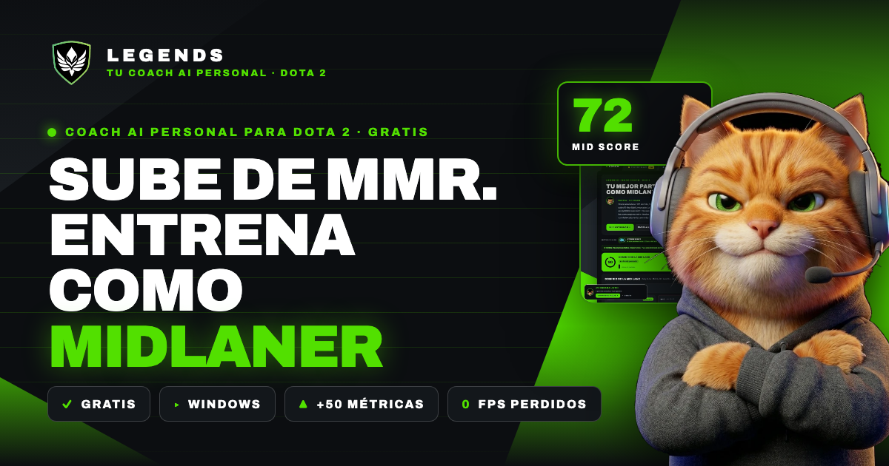
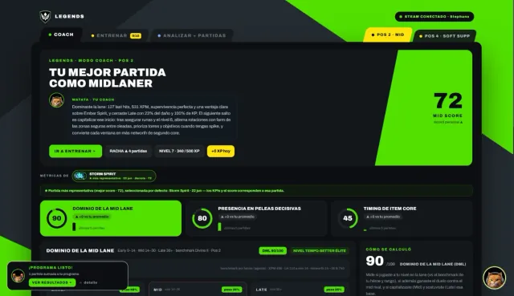
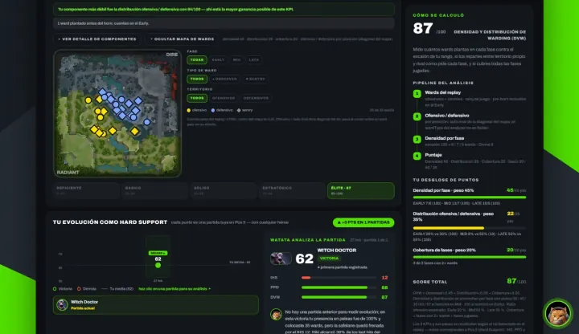
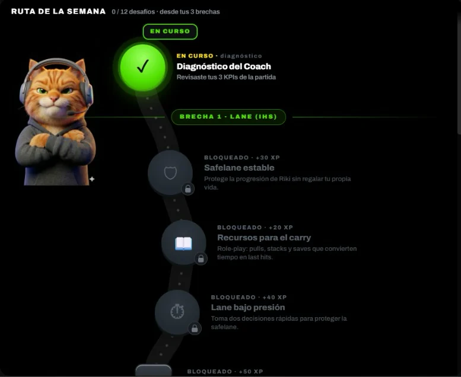
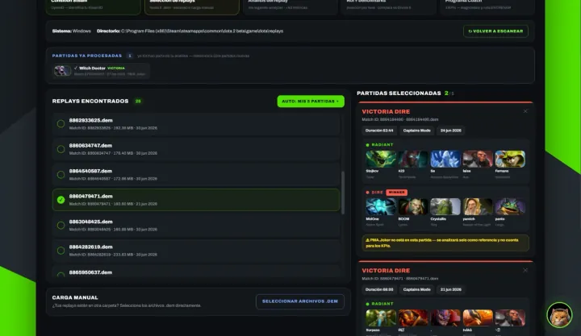

<div align="center">

<a href="https://legendslatam.com/">
  
</a>

# Legends · Tu Coach AI Personal para Dota 2

**Sube de MMR entrenando lo que de verdad te frena.**<br>
Legends analiza tus replays, encuentra tus 3 brechas según tu rol y te arma una ruta semanal con desafíos, XP y cofres. Gratis y sin Pay to Win.

[](https://github.com/legends-latam/desktop-legends-release/releases/)
[](https://github.com/legends-latam/desktop-legends-release/releases/)
[](https://legendslatam.com/)
[](https://discord.gg/XtGmMgDm3)

**[▸ Descargar para Windows](https://github.com/legends-latam/desktop-legends-release/releases/)** &nbsp;·&nbsp;
**[legendslatam.com](https://legendslatam.com/)** &nbsp;·&nbsp;
**[Únete a Legends Beta en Discord](https://discord.gg/XtGmMgDm3)**

</div>

---

## ¿Por qué Legends?

Jugar más partidas no te sube de MMR si repites los mismos errores. Legends revisa tus partidas como lo haría un coach: mira qué hiciste en cada fase, lo compara con jugadores de tu rango y te dice **qué entrenar esta semana** para subir. Watata, el gato con headset, te lo explica sin rodeos.

| | |
|---|---|
| **✓ Gratis de verdad** | Descargas, conectas Steam y entrenas. No vendemos ventajas: el progreso se gana entrenando. |
| **▲ +50 métricas por partida** | Farm, presencia en peleas, timings de ítems core, wards y más, extraídas de tu replay `.dem`. |
| **▸ Hecho para tu rol** | Detecta si jugaste Carry, Mid, Offlane o Support y te mide con los 3 KPIs que importan en esa posición, con el cálculo a la vista. |
| **✕ 0 FPS perdidos** | El análisis corre fuera de la partida. No toca el cliente del juego, no es un cheat ni un overlay y no te sube el ping. |

## Mira cómo se ve

<table>
  <tr>
    <td width="50%" valign="top">
      
      <p><b>Modo Coach</b><br>Tu puntaje por rol, tus 3 KPIs y lo que Watata opina de tu partida, en una sola pantalla.</p>
    </td>
    <td width="50%" valign="top">
      
      <p><b>Diagnóstico con el cálculo a la vista</b><br>Mapa de wards, desglose de puntos por fase y tu evolución partida a partida.</p>
    </td>
  </tr>
  <tr>
    <td width="50%" valign="top">
      
      <p><b>Tu ruta de la semana</b><br>12 desafíos armados desde tus 3 brechas. Completa nodos, gana XP, abre cofres y cuida tu racha.</p>
    </td>
    <td width="50%" valign="top">
      
      <p><b>Tus replays, sin complicaciones</b><br>Legends encuentra tu carpeta de replays de Dota 2. Eliges hasta 5 partidas y listo.</p>
    </td>
  </tr>
</table>

## Empieza en 3 pasos

1. **Descarga Legends** desde [Releases](https://github.com/legends-latam/desktop-legends-release/releases/) (Windows, 64 bits) o pide tu invitación en el [Discord de Legends Beta](https://discord.gg/XtGmMgDm3).
2. **Conecta Steam** con Steam OpenID (nunca te pedimos tu contraseña) y elige hasta 5 replays.
3. **Recibe tu diagnóstico** y tu ruta por rol en minutos. Entrena, juega y vuelve a medir.

## Resultados reales

> **Diego subió 1.200 MMR en 3 meses** jugando y entrenando con Legends.

¿Subiste de MMR con Legends? Cuéntalo en el [Discord](https://discord.gg/XtGmMgDm3) y podemos sumar tu caso.

## Juegos

| Juego | Estado |
|---|---|
| Dota 2 | **Disponible** |
| League of Legends | En desarrollo |
| Fortnite · Deadlock | Planeados |

## Descargas

Las versiones de la app de escritorio se publican en **[legends-latam/desktop-legends-release › Releases](https://github.com/legends-latam/desktop-legends-release/releases/)**. Busca el instalador `Legends_<versión>_x64-setup.exe` en la última versión. Las novedades y las invitaciones a la beta llegan primero al [Discord de Legends Beta](https://discord.gg/XtGmMgDm3).

## Síguenos

[TikTok](https://www.tiktok.com/@legends.dsv) · [YouTube](https://www.youtube.com/@Legendsdsv) · [Instagram](https://www.instagram.com/legends.dsv) · [Discord](https://discord.gg/XtGmMgDm3)

---

<details>
<summary><b>Para desarrolladores: este repositorio (legendslatam.com)</b></summary>

<br>

Este repositorio es la landing [legendslatam.com](https://legendslatam.com/), hecha con **React + Vite + TypeScript y prerenderizada a HTML estático** para GitHub Pages. Cada ruta se renderiza en el build con `react-dom/server`, así el HTML completo (texto, FAQ, JSON-LD) llega a Google y a los rastreadores de IA sin ejecutar JavaScript. Después React se hidrata para las animaciones, el canvas, el sonido y el modal de descarga.

[](https://github.com/legends-latam/legends-landing/actions/workflows/deploy-pages.yml)

### Comandos

```bash
npm install
npm run dev        # desarrollo en http://localhost:5173 (sin prerender)
npm run build      # → dist (cliente + SSR + prerender de /, /descargar/ y 404)
npm run preview    # sirve dist en http://localhost:4173
npm run images     # regenera las variantes de imágenes (solo si cambian los originales en assets/)
```

Lighthouse móvil (1 de octubre de 2026): accesibilidad 100, buenas prácticas 100, SEO 100 y rendimiento 99 con limitación simulada (la que usa PageSpeed Insights).

### Estructura

| Ruta | Qué es |
|---|---|
| `src/pages/Landing.tsx` | Estado `{ roleIdx, step, mmr, done, faq, sound }` y el efecto de montaje (reveals, rotación de rol, pasos, parallax, canvas, audio). |
| `src/sections/*.tsx` | Las secciones del diseño (Header, Hero, Trust, Problem, Offer, Route, Results, Faq, Closing, Footer), con los estilos inline del diseño original. |
| `src/data/faq.ts` | Las 9 preguntas: alimentan el acordeón y el JSON-LD `FAQPage`. |
| `src/sections/DiscordModal.tsx` | Modal de Legends Beta que abren los CTA de descarga y la constante `DISCORD_BETA` con la invitación. |
| `src/lib/release.ts` | Resolvedor del instalador en GitHub Releases. **Sin uso** mientras la descarga del sitio ocurra en Discord. |
| `src/lib/fx.ts` | Canvas del hero y motor de sonido (Web Audio). |
| `src/seo.ts` | `<title>`, metadatos, Open Graph/Twitter y JSON-LD por ruta. `index.html` solo lleva lo común a todas las páginas. |
| `src/styles.css` | CSS global (container queries, animaciones, `prefers-reduced-motion`). |
| `src/pages/Descargar.tsx` · `NotFound.tsx` | `/descargar/` y `404.html`. |
| `public/` | `robots.txt`, `llms.txt`, `sitemap.xml`, `site.webmanifest`, `og-image.png`, favicons, `CNAME`, `.nojekyll`, la fuente Archivo (`fonts/`) y las imágenes (`assets/`). |
| `prerender.mjs` | Genera el HTML estático de cada ruta e incrusta el CSS crítico. |
| `scripts/` | `images.mjs` (variantes responsive con sharp) y `html2jsx.py` (conversor usado para portar el diseño). |
| `static/` · `design/` · `assets/` | Referencia del diseño original de Claude Design y los originales de las imágenes. `CLAUDE.md` es el brief. |

### Cómo funciona la descarga en el sitio

El sitio no entrega el `.exe`: los CTA abren el modal de Legends Beta, que lleva a la invitación de Discord (`DISCORD_BETA` en `src/sections/DiscordModal.tsx`). Sin JavaScript abren Discord en otra pestaña. Si la invitación cambia o vence, actualiza `DISCORD_BETA` y los enlaces de `public/llms.txt` y de este README.

### Publicar en GitHub Pages

1. Haz push a `main`. El workflow `.github/workflows/deploy-pages.yml` comprueba tipos, construye y publica `dist`.
2. En **Settings → Pages**, elige **Source: GitHub Actions**.
3. En **Settings → Pages → Custom domain** escribe `legendslatam.com` y activa **Enforce HTTPS** cuando el certificado esté listo.
4. DNS del dominio:
   - `A` en `@` → `185.199.108.153`, `185.199.109.153`, `185.199.110.153`, `185.199.111.153`
   - `AAAA` en `@` → `2606:50c0:8000::153`, `2606:50c0:8001::153`, `2606:50c0:8002::153`, `2606:50c0:8003::153`
   - `CNAME` en `www` → `legends-latam.github.io`
5. Verifica el dominio en **Settings → Pages → Verified domains** de la organización.
6. Envía `https://legendslatam.com/sitemap.xml` en Google Search Console y en Bing Webmaster Tools.

</details>

<sub>Dota 2 y Deadlock son marcas de Valve Corporation; League of Legends, de Riot Games; Fortnite, de Epic Games. Legends no está afiliado a ninguna de ellas.</sub>
